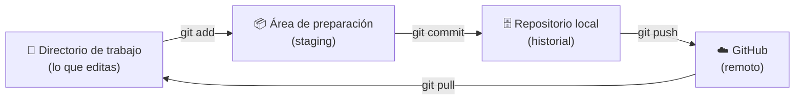

# 1. Conceptos básicos

[← Inicio](../README.md) · [Siguiente: Instalación →](02-instalacion.md)

## ¿Qué problema resuelve Git?

Sin control de versiones, los equipos terminan con carpetas así:

```
sistema_final.zip
sistema_final_v2.zip
sistema_final_v2_CORREGIDO.zip
sistema_final_v2_CORREGIDO_juan.zip
```

Nadie sabe qué cambió, quién lo cambió, ni cómo volver a una versión que funcionaba.

**Git** es un programa que registra cada cambio de tus archivos como una "fotografía" con autor, fecha y descripción. Permite:

- Volver a cualquier versión anterior.
- Ver exactamente qué líneas cambió cada persona y por qué.
- Que varias personas trabajen al mismo tiempo sin pisarse.
- Probar ideas en paralelo sin poner en riesgo lo que ya funciona.

## Git vs. GitHub

| | **Git** | **GitHub** |
|---|---------|-----------|
| Qué es | Un programa | Un sitio web / servicio en la nube |
| Dónde vive | En tu computadora | En internet (github.com) |
| Para qué sirve | Registrar versiones de archivos | Guardar repositorios Git en la nube y colaborar |
| ¿Necesita internet? | No | Sí |
| Alternativas | — | GitLab, Bitbucket, Azure DevOps |

Una analogía: **Git es como el correo electrónico** (el estándar) y **GitHub es como Gmail** (un proveedor que lo ofrece con extras: interfaz web, permisos, revisiones, automatizaciones).

## Vocabulario mínimo

| Término | Significado |
|---------|-------------|
| **Repositorio (repo)** | Carpeta de un proyecto cuyo historial controla Git. |
| **Commit** | Una "fotografía" guardada de los cambios, con mensaje, autor y fecha. |
| **Historial** | La lista de todos los commits del repositorio. |
| **Rama (branch)** | Una línea de trabajo independiente. La principal suele llamarse `main`. |
| **Merge** | Unir los cambios de una rama en otra. |
| **Remoto (remote)** | Copia del repositorio en un servidor (por ejemplo, GitHub). Por convención se llama `origin`. |
| **Clone** | Descargar un repositorio remoto completo, con todo su historial. |
| **Push** | Subir tus commits locales al remoto. |
| **Pull** | Bajar los commits nuevos del remoto a tu computadora. |
| **Pull request (PR)** | En GitHub: solicitud para revisar y unir una rama a otra. |
| **Tag** | Etiqueta fija sobre un commit, normalmente para marcar versiones (`v1.0.0`). |

## Las tres zonas de Git

Cada archivo pasa por tres zonas antes de quedar registrado:



1. **Directorio de trabajo:** tus archivos tal como los ves y editas.
2. **Staging (preparación):** eliges qué cambios entran en la próxima fotografía. Es como poner cosas en una caja antes de cerrarla.
3. **Repositorio local:** al hacer `commit`, la caja se cierra y se guarda en el historial.

Después, con `push`, envías esos commits a GitHub para que otros los vean y para tener respaldo.

## Lo más importante para este manual

> **El historial vive dentro del repositorio** (en una carpeta oculta llamada `.git`).

Por eso es posible **mover un proyecto completo con todo su historial** de un lugar a otro: basta con copiar ese contenido a un repositorio nuevo. Lo veremos paso a paso en el [capítulo 6](06-migracion.md).

---

[← Inicio](../README.md) · [Siguiente: Instalación →](02-instalacion.md)
