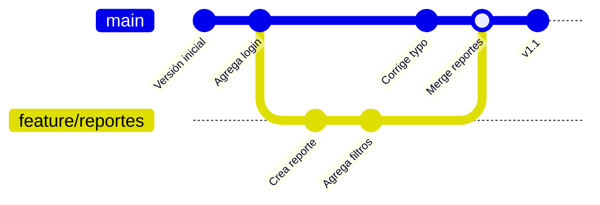

# 4. Ramas y flujo diario

[← Tu primer repositorio](03-primer-repositorio.md) · [Siguiente: Trabajo en equipo →](05-trabajo-en-equipo.md)

## ¿Qué es una rama?

Una rama es una **línea de trabajo paralela**. La rama `main` contiene la versión estable; cada funcionalidad o corrección nueva se desarrolla en su propia rama y, cuando está lista y revisada, se une a `main`.



**Ventaja:** si el experimento sale mal, borras la rama y `main` nunca se enteró.

## Comandos de ramas

| Acción | Comando |
|--------|---------|
| Ver ramas locales (la actual tiene `*`) | `git branch` |
| Ver también las remotas | `git branch -a` |
| Crear una rama y cambiarte a ella | `git switch -c feature/reportes` |
| Cambiarte a una rama existente | `git switch main` |
| Subir una rama nueva a GitHub | `git push -u origin feature/reportes` |
| Unir otra rama a la actual | `git merge feature/reportes` |
| Borrar una rama local ya unida | `git branch -d feature/reportes` |
| Borrar una rama en GitHub | `git push origin --delete feature/reportes` |

> Antes de cambiar de rama, haz commit de tus cambios. Si no estás listo, guárdalos temporalmente con `git stash` y recupéralos después con `git stash pop`.

## Convención de nombres

| Prefijo | Uso | Ejemplo |
|---------|-----|---------|
| `feature/` | Funcionalidad nueva | `feature/exportar-excel` |
| `fix/` | Corrección de error | `fix/login-timeout` |
| `hotfix/` | Corrección urgente en producción | `hotfix/caida-api-pagos` |
| `docs/` | Solo documentación | `docs/manual-usuario` |

> El catálogo completo de tipos (`chore/`, `refactor/`, `release/`, `test/`…) y las reglas para nombrar ramas están en el [capítulo 10](10-estrategia-de-ramas.md#103-catálogo-de-tipos-de-rama).

## El flujo diario recomendado (GitHub Flow)

Es el flujo más sencillo y el que recomienda GitHub. Ideal para aprender:

> Si tu equipo trabaja con versiones planificadas y ambientes de prueba, usa **Git Flow** (ramas `main` + `develop`), explicado en el [capítulo 10](10-estrategia-de-ramas.md).

```powershell
# 1. Actualiza main
git switch main
git pull

# 2. Crea tu rama
git switch -c feature/exportar-excel

# 3. Trabaja y guarda tantas veces como necesites
git add .
git commit -m "Agrega botón de exportación"

# 4. Sube la rama
git push -u origin feature/exportar-excel

# 5. Abre un Pull Request en GitHub (capítulo 5)
# 6. Tras la aprobación y el merge, limpia:
git switch main
git pull
git branch -d feature/exportar-excel
```

## Conflictos de merge

Ocurren cuando dos ramas modificaron **las mismas líneas** del mismo archivo. Git no adivina cuál es la correcta y te pide decidir. El archivo queda así:

```text
<<<<<<< HEAD
Precio con IVA: 16%
=======
Precio con IVA: 15%
>>>>>>> feature/nuevo-impuesto
```

**Para resolverlo:**

1. Abre el archivo (VS Code muestra botones *Accept Current / Accept Incoming / Accept Both*).
2. Deja el contenido correcto y **borra las marcas** `<<<<<<<`, `=======`, `>>>>>>>`.
3. Guarda y ejecuta:

```powershell
git add archivo-en-conflicto.txt
```
```powershell
git commit
```

¿Te arrepentiste a la mitad? `git merge --abort` deja todo como estaba antes del merge.

> **Cómo evitar conflictos:** ramas de vida corta (días, no semanas), `git pull` frecuente y commits pequeños.

## Versiones con tags

Para marcar una versión entregada:

```powershell
git tag -a v1.0.0 -m "Primera versión en producción"
```
```powershell
git push origin v1.0.0
```

En GitHub puedes convertir un tag en un **Release** (*Releases → Draft a new release*) con notas de la versión y archivos adjuntos.

---

[← Tu primer repositorio](03-primer-repositorio.md) · [Siguiente: Trabajo en equipo →](05-trabajo-en-equipo.md)
