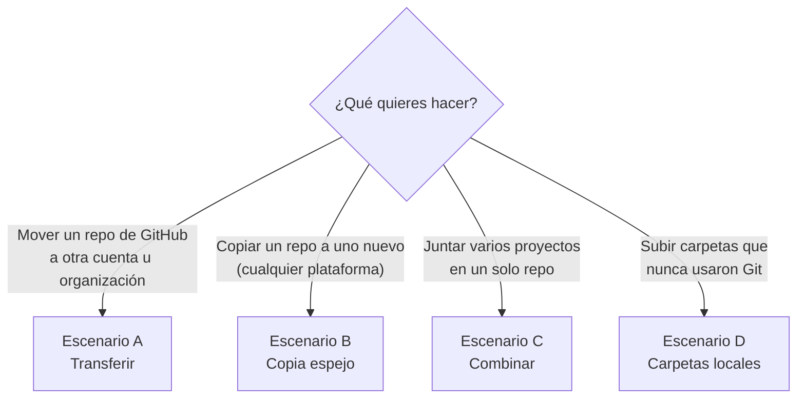

# 6. Migrar repositorios con todo su historial

[← Trabajo en equipo](05-trabajo-en-equipo.md) · [Siguiente: Buenas prácticas →](07-buenas-practicas.md)

> **Sí, se puede.** Como vimos en el [capítulo 1](01-conceptos.md#lo-más-importante-para-este-manual), el historial vive dentro del repositorio. Al migrar correctamente conservas **todos los commits, autores, fechas, ramas y tags**.

## Elige tu escenario



| | Código e historial | Ramas y tags | Issues y PRs | Redirige URL antigua |
|---|:---:|:---:|:---:|:---:|
| **A. Transferir** | ✅ | ✅ | ✅ | ✅ |
| **B. Copia espejo** | ✅ | ✅ | ❌ | ❌ |
| **C. Combinar** | ✅ | Solo la rama elegida | ❌ | ❌ |
| **D. Carpetas locales** | No había historial | — | — | — |

## Antes de empezar (lista de verificación)

- [ ] Avisa al equipo y define una hora sin cambios ("congelamiento").
- [ ] Pide que todos suban (`git push`) su trabajo pendiente.
- [ ] Verifica que tienes permiso de **Admin** en el repositorio origen y permiso para crear repositorios en el destino.
- [ ] Anota qué hay además del código: issues, wiki, releases, secrets, webhooks, GitHub Actions.
- [ ] Revisa si el repo usa **Git LFS** (archivos grandes): existe un archivo `.gitattributes` con la palabra `lfs`.

---

## Escenario A: Transferir

**Úsalo cuando:** el repositorio ya está en GitHub y solo cambia de dueño (de tu cuenta personal a la organización de la empresa, o entre organizaciones).

1. Repositorio origen → **Settings** → **General** → baja hasta **Danger Zone**.
2. **Transfer ownership** → escribe el nuevo dueño → confirma escribiendo el nombre del repositorio.

**Qué pasa:**

- Se mueve **todo**: código, historial, issues, PRs, wiki, releases y estrellas.
- GitHub **redirige** automáticamente la URL antigua (para la web y para `git clone`/`push`).
- Aun así, actualiza tus copias locales para usar la URL nueva:

```powershell
git remote set-url origin https://github.com/nueva-org/repo.git
```

> No vuelvas a crear un repositorio con el mismo nombre en el lugar de origen: eso rompe la redirección.

---

## Escenario B: Copia espejo

**Úsalo cuando:** quieres un repositorio **nuevo e independiente** con el mismo historial. Funciona desde cualquier plataforma (GitHub, GitLab, Bitbucket, Azure DevOps, servidor propio) hacia GitHub.

### Paso 1. Crea el repositorio destino **vacío**

En GitHub: **New repository** → **no** marques README, .gitignore ni licencia. Debe estar completamente vacío.

### Paso 2. Copia y sube

```powershell
# Clona una copia "desnuda" (solo el historial, sin archivos de trabajo)
git clone --bare https://github.com/usuario/repo-viejo.git

cd repo-viejo.git

# Sube TODO (ramas, tags e historial) al repositorio nuevo
git push --mirror https://github.com/usuario/repo-nuevo.git
```

### Paso 3. Si el repositorio usa Git LFS

Ejecuta esto dentro de la misma carpeta `repo-viejo.git`:

```powershell
git lfs fetch --all
```
```powershell
git lfs push --all https://github.com/usuario/repo-nuevo.git
```

### Paso 4. Limpia

```powershell
cd ..
```
```powershell
Remove-Item -Recurse -Force repo-viejo.git
```

### Paso 5. Migra la wiki (si la tiene)

La wiki es un repositorio aparte. Primero, en el repo nuevo, crea una página cualquiera en la pestaña **Wiki** para inicializarla. Luego:

```powershell
git clone --bare https://github.com/usuario/repo-viejo.wiki.git
```
```powershell
cd repo-viejo.wiki.git
```
```powershell
git push --mirror https://github.com/usuario/repo-nuevo.wiki.git
```

> **Atajo:** el script [`scripts/migrar-repo.ps1`](../scripts/migrar-repo.ps1) hace los pasos 2 a 4 y además **verifica** que todas las ramas y tags hayan llegado.
>
> ```powershell
> .\scripts\migrar-repo.ps1 -Origen https://github.com/usuario/repo-viejo.git -Destino https://github.com/usuario/repo-nuevo.git
> ```

### Alternativa sin comandos: GitHub Importer

Para repos que vienen de **otra plataforma**: entra a <https://github.com/new/import>, pega la URL del repositorio origen (y credenciales si es privado), elige el nombre del nuevo repo y espera el correo de confirmación. Migra código, historial, ramas y tags.

### ¿Y los issues y pull requests?

La copia espejo no los incluye. Opciones:

- **Entre organizaciones de GitHub:** **GitHub Enterprise Importer** migra también issues, PRs, comentarios y wiki. Se usa con GitHub CLI:

  ```powershell
  gh extension install github/gh-gei
  ```
  ```powershell
  gh gei migrate-repo --github-source-org ORG-ORIGEN --source-repo REPO --github-target-org ORG-DESTINO --target-repo REPO
  ```

  Requiere tokens con permisos de administrador en ambas organizaciones. Consulta la [documentación oficial](https://docs.github.com/es/migrations).
- **Si no puedes usarlo:** usa el escenario A (transferir), o deja el repo antiguo **archivado** como consulta (ver [Después de migrar](#después-de-migrar)).

---

## Escenario C: Juntar varios proyectos en un solo repositorio

**Úsalo cuando:** tienes varios repositorios pequeños y quieres un único repositorio (*monorepo*) con una carpeta por proyecto, **conservando el historial de cada uno**.

Resultado:

```
repo-nuevo/
├── README.md
├── proyecto-inventario/   ← con todo su historial
├── proyecto-tickets/      ← con todo su historial
└── proyecto-reportes/     ← con todo su historial
```

### Método sencillo: `git subtree`

Viene incluido con Git para Windows.

```powershell
# 1. Crea el repo nuevo en GitHub CON un README y clónalo
git clone https://github.com/empresa/repo-nuevo.git
cd repo-nuevo

# 2. Por cada proyecto: carpeta destino, URL y rama a importar
git subtree add --prefix=proyecto-inventario https://github.com/empresa/inventario.git main
git subtree add --prefix=proyecto-tickets    https://github.com/empresa/tickets.git    main
git subtree add --prefix=proyecto-reportes   https://github.com/empresa/reportes.git   master

# 3. Sube el resultado
git push
```

> Fíjate en la **rama** de cada proyecto: los repositorios antiguos suelen usar `master` en lugar de `main`. Compruébala con `git ls-remote --symref <url> HEAD`.

Para consultar el historial de un proyecto dentro del monorepo:

```powershell
git log --oneline -- proyecto-inventario
```

> **Atajo:** el script [`scripts/combinar-repos.ps1`](../scripts/combinar-repos.ps1) lee una lista de proyectos desde un CSV ([ejemplo](../scripts/proyectos-ejemplo.csv)) y ejecuta todos los `subtree add` por ti.

### Método avanzado: `git filter-repo`

Con `git subtree`, al consultar el historial antiguo los archivos aparecen con su ruta original (sin la carpeta). Si quieres que el historial muestre los archivos **como si siempre hubieran vivido en su carpeta**, reescribe cada proyecto antes de unirlo:

```powershell
# Requiere Python
pip install git-filter-repo

# 1. Clona el proyecto en una carpeta temporal y mueve todo a su subcarpeta
git clone https://github.com/empresa/inventario.git temp-inventario
cd temp-inventario
git filter-repo --to-subdirectory-filter proyecto-inventario
cd ..

# 2. En el repo nuevo, une ese historial
cd repo-nuevo
git remote add inventario ..\temp-inventario
git fetch inventario
git merge inventario/main --allow-unrelated-histories -m "Integra proyecto-inventario con su historial"
git remote remove inventario
git push
```

Repite para cada proyecto.

---

## Escenario D: Carpetas locales sin Git

**Úsalo cuando:** los proyectos están en carpetas, un servidor de archivos o un ZIP, y nunca usaron Git. No hay historial que conservar; el historial **empieza hoy**.

1. Crea un `.gitignore` adecuado (ver [capítulo 3](03-primer-repositorio.md#el-archivo-gitignore)).
2. **Revisa que no haya contraseñas** ni cadenas de conexión en los archivos (ver [capítulo 7](07-buenas-practicas.md#seguridad)).
3. Sigue el [Camino B del capítulo 3](03-primer-repositorio.md#camino-b-subir-una-carpeta-existente).

> Si tienes varias versiones en carpetas (`v1`, `v2`, `v3`), puedes reconstruir un historial aproximado: copia el contenido de `v1` y haz commit, reemplázalo con `v2` y haz commit, y así sucesivamente.

---

## Después de migrar

### 1. Verifica

```powershell
# Compara ramas y tags del origen y del destino: deben ser idénticos
git ls-remote --heads --tags https://github.com/usuario/repo-viejo.git
git ls-remote --heads --tags https://github.com/usuario/repo-nuevo.git
```

En GitHub, revisa en el repo nuevo: número de commits, ramas (*branches*), tags y que el código se vea completo.

### 2. Reconfigura lo que no viaja con Git

- [ ] **Settings → Collaborators and teams:** permisos.
- [ ] **Settings → Rules:** protección de `main` (ver [capítulo 5](05-trabajo-en-equipo.md#proteger-la-rama-main)).
- [ ] **Settings → Secrets and variables:** secretos de GitHub Actions (no se pueden leer, hay que volver a cargarlos).
- [ ] **Settings → Webhooks** e integraciones (Slack, Teams, Jira…).
- [ ] **Releases:** se migran los tags, pero no las notas ni los archivos adjuntos de los releases.

### 3. Actualiza las copias locales del equipo

Cada persona, en su carpeta del proyecto:

```powershell
git remote set-url origin https://github.com/usuario/repo-nuevo.git
```
```powershell
git remote -v
```

O, más sencillo, que cada uno vuelva a clonar desde el repo nuevo.

### 4. Archiva el repositorio antiguo

**No lo borres de inmediato.** En el repo viejo: *Settings → Danger Zone → Archive this repository*. Queda en modo solo lectura como respaldo. Edita su README para indicar la nueva ubicación.

---

[← Trabajo en equipo](05-trabajo-en-equipo.md) · [Siguiente: Buenas prácticas →](07-buenas-practicas.md)
