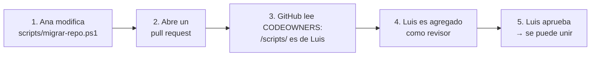

# 9. Seguridad y gestión de colaboradores

[← Solución de problemas](08-solucion-de-problemas.md) · [Siguiente: Estrategia de ramas →](10-estrategia-de-ramas.md)

El código fuente es uno de los activos más valiosos del área de TI. Este capítulo explica **quién puede entrar, qué puede hacer y cómo detectar riesgos** en tus repositorios de GitHub.

## Contenido

1. [Cuenta personal u organización](#91-cuenta-personal-u-organización)
2. [Agregar colaboradores a un repositorio personal](#92-agregar-colaboradores-a-un-repositorio-personal)
3. [Gestionar personas en una organización](#93-gestionar-personas-en-una-organización)
4. [Roles y permisos](#94-roles-y-permisos)
5. [Alta y baja de personas (onboarding y offboarding)](#95-alta-y-baja-de-personas)
6. [Proteger las cuentas](#96-proteger-las-cuentas)
7. [Responsables de código (CODEOWNERS)](#97-responsables-de-código-codeowners)
8. [Funciones de seguridad del repositorio](#98-funciones-de-seguridad-del-repositorio)
9. [Tokens, llaves y accesos de sistemas](#99-tokens-llaves-y-accesos-de-sistemas)
10. [Commits firmados](#910-commits-firmados)
11. [Auditoría y revisión periódica](#911-auditoría-y-revisión-periódica)
12. [Lista de verificación](#912-lista-de-verificación)

---

## 9.1 Cuenta personal u organización

Lo primero es decidir **a quién pertenece** el repositorio, porque eso define qué controles de seguridad tienes disponibles.

| | **Cuenta personal** | **Organización** |
|---|---|---|
| Dueño del código | Una persona | La empresa |
| Niveles de permiso | Solo "dueño" o "colaborador" | Read, Triage, Write, Maintain, Admin |
| Equipos (grupos de personas) | ❌ | ✅ |
| Exigir 2FA a todos | ❌ | ✅ |
| Registro de auditoría | ❌ | ✅ |
| Si la persona deja la empresa | El código se va con ella | El código se queda |

> **Recomendación:** usa cuentas personales solo para aprender o para proyectos propios. **Todo repositorio de la empresa debe vivir en una organización.** Si ya tienes repositorios en tu cuenta personal, transfiérelos ([capítulo 6, escenario A](06-migracion.md#escenario-a-transferir)).

---

## 9.2 Agregar colaboradores a un repositorio personal

1. Abre el repositorio → **Settings**.
2. Menú izquierdo, sección *Access* → **Collaborators**.
3. GitHub puede pedirte tu contraseña o tu 2FA para confirmar.
4. **Add people** → escribe el usuario, nombre completo o correo → **Add to repository**.
5. La persona recibe una invitación por correo y en <https://github.com/notifications>. **Debe aceptarla**; la invitación vence a los 7 días.

**Limitación importante:** en un repositorio personal, todo colaborador recibe permisos de **escritura** (puede subir código, crear ramas y gestionar issues). No hay forma de dar solo lectura. Si necesitas permisos más finos, usa una organización.

**Para quitar a un colaborador:** misma pantalla → botón de **Remove** junto a su nombre.

---

## 9.3 Gestionar personas en una organización

### Invitar miembros

1. Página de la organización → **People** → **Invite member**.
2. Escribe el usuario o correo y elige el rol:
   - **Member:** miembro normal.
   - **Owner:** control total de la organización. **Limítalo a 2 personas** (titular y respaldo).
3. Elige los equipos a los que se unirá (paso opcional, pero recomendado).

### Crear equipos

Asignar permisos por **equipo** en vez de persona por persona simplifica la administración: cuando alguien entra o sale, solo lo agregas o quitas del equipo.

1. Organización → **Teams** → **New team**.
2. Nombre por área o función: `desarrollo`, `infraestructura`, `soporte`, `auditoria`.
3. **Visibility:** *Visible* (todos los miembros lo ven) o *Secret* (solo sus integrantes).
4. Dentro del equipo → **Members** → **Add a member**.

### Dar acceso a un repositorio

1. Repositorio → **Settings** → **Collaborators and teams**.
2. **Add teams** (recomendado) o **Add people**.
3. Elige el rol (ver [9.4](#94-roles-y-permisos)).

### Colaboradores externos

Proveedores, consultores o personal temporal pueden recibir acceso **solo a repositorios específicos**, sin ser miembros de la organización. Se agregan con **Add people** en el repositorio. En *People → Outside collaborators* ves la lista completa.

> **Buena práctica:** a los externos dales siempre el permiso mínimo y una fecha de revisión. Anótala en el issue o ticket donde se aprobó su acceso.

### Permiso base de la organización

*Organización → Settings → Member privileges → Base permissions* define qué pueden hacer **todos** los miembros en **todos** los repositorios.

| Valor | Efecto |
|---|---|
| **No permission** ✅ recomendado | Solo ven los repos a los que se les dio acceso explícito |
| **Read** | Todos pueden ver y clonar todos los repos |
| **Write** / **Admin** | ⚠️ No recomendado |

En la misma página, desactiva **Repository creation** para miembros si quieres que solo los administradores creen repositorios, y revisa **Repository forking** para controlar si se pueden hacer copias de repos privados.

---

## 9.4 Roles y permisos

### Roles por repositorio

| Rol | Ver y clonar | Issues y PRs | Subir código | Configuración | Borrar repo | Ideal para |
|---|:-:|:-:|:-:|:-:|:-:|---|
| **Read** | ✅ | Comentar | ❌ | ❌ | ❌ | Auditoría, consulta, otras áreas |
| **Triage** | ✅ | Gestionar | ❌ | ❌ | ❌ | Mesa de ayuda, líderes de proyecto |
| **Write** | ✅ | ✅ | ✅ | ❌ | ❌ | **Desarrolladores** |
| **Maintain** | ✅ | ✅ | ✅ | Parcial | ❌ | Líder técnico del proyecto |
| **Admin** | ✅ | ✅ | ✅ | ✅ | ✅ | 1–2 responsables |

### Roles en la organización

| Rol | Qué puede hacer |
|---|---|
| **Owner** | Todo: facturación, miembros, configuración y borrar la organización |
| **Member** | Lo que le den sus equipos y el permiso base |
| **Security manager** | Ver y gestionar alertas de seguridad de todos los repos |
| **Billing manager** | Solo facturación |
| **Outside collaborator** | Solo los repos donde fue invitado |

> **Principio de mínimo privilegio:** da el rol más bajo que permita hacer el trabajo. Es más fácil subir un permiso cuando se necesita que descubrir que alguien tenía más del que debía.

---

## 9.5 Alta y baja de personas

### Alta (onboarding)

- [ ] La persona crea su cuenta de GitHub con el **correo corporativo** (o lo agrega a su cuenta existente).
- [ ] Activa la **verificación en dos pasos** antes de recibir la invitación.
- [ ] Se le invita a la organización como **Member**.
- [ ] Se le agrega a su **equipo**, no a repositorios sueltos.
- [ ] Recibe este manual (capítulos 1 a 5 y la estrategia de ramas del capítulo 10).

### Baja (offboarding), el mismo día de su salida

- [ ] Organización → **People** → selecciona a la persona → **Remove from organization**. Pierde acceso a todos los repos y equipos.
- [ ] Revisa *Outside collaborators* por si también estaba como externo.
- [ ] **Rota los secretos** que conocía: contraseñas, tokens o llaves de servidores de los proyectos donde trabajó.
- [ ] Revisa sus **deploy keys**, **webhooks** y **tokens aprobados** (ver [9.9](#99-tokens-llaves-y-accesos-de-sistemas)).
- [ ] Reasigna sus issues y PRs abiertos.

> Si la persona tenía repositorios de la empresa en su **cuenta personal**, transfiérelos a la organización **antes** de su salida.

---

## 9.6 Proteger las cuentas

### Exigir verificación en dos pasos (2FA)

*Organización → Settings → Authentication security → Require two-factor authentication for everyone*.

> ⚠️ Al activarlo, **GitHub elimina de la organización a quienes no tengan 2FA activado**. Antes de activarlo, revisa en *People* el filtro **2FA → Disabled** y pide a esas personas que lo activen.

### Métodos de 2FA recomendados (de más a menos seguro)

1. **Llave de seguridad física o passkey** (YubiKey, Windows Hello, huella).
2. **App autenticadora** (Microsoft Authenticator, Google Authenticator, 1Password…).
3. **GitHub Mobile.**
4. SMS: es la opción menos segura, úsala solo si no hay otra.

Guarda los **códigos de recuperación** en un lugar seguro, como el gestor de contraseñas de la empresa. Si se pierden junto con el dispositivo, se pierde la cuenta.

---

## 9.7 Responsables de código (CODEOWNERS)

### ¿Qué es y para qué sirve?

Piensa en un edificio de oficinas: cada área tiene un **responsable**. Si alguien quiere cambiar algo en la sala de servidores, debe autorizarlo el jefe de infraestructura; si quiere cambiar algo en contabilidad, lo autoriza el contador.

`CODEOWNERS` hace lo mismo con el código. Es un **archivo de texto** donde escribes **qué carpetas o archivos** tiene a cargo **cada persona o equipo**. Cuando alguien abre un pull request que modifica esos archivos, **GitHub pide automáticamente la revisión a su responsable**. Ya no tienes que acordarte de asignar revisores a mano.

### Cómo funciona, paso a paso



### Dónde se guarda

El archivo se llama exactamente **`CODEOWNERS`**, en mayúsculas y **sin extensión** (no `.txt`, no `.md`). Va dentro de la carpeta `.github` en la raíz del repositorio:

```text
curso-git/
├── .github/
│   └── CODEOWNERS      ← aquí
├── docs/
├── scripts/
└── README.md
```

> GitHub también lo acepta en la raíz o dentro de `docs/`, pero `.github/` es el lugar más común.

### Cómo se lee una línea

Cada línea es una regla con **dos partes**, separadas por espacios:

```text
/scripts/       @luis-infra
└───┬───┘       └────┬────┘
 ¿QUÉ archivos?  ¿QUIÉN los revisa?
```

| Parte | Qué escribir | Ejemplo |
|---|---|---|
| **¿Qué archivos?** | Una carpeta, un archivo o un tipo de archivo | `/scripts/`, `README.md`, `*.ps1` |
| **¿Quién revisa?** | Uno o varios responsables, separados por espacios | `@luis-infra` o `@luis-infra @ana-dev` |

Los responsables se escriben de tres formas:

| Forma | Significa | Ejemplo |
|---|---|---|
| `@usuario` | Una persona (su usuario de GitHub) | `@pegre369` |
| `@organizacion/equipo` | Un equipo completo de una organización ([9.3](#93-gestionar-personas-en-una-organización)) | `@mi-empresa/infraestructura` |
| `correo@empresa.com` | Una persona, por el correo de su cuenta de GitHub | `luis@empresa.com` |

Las líneas que empiezan con **`#`** son **comentarios**: GitHub las ignora y sirven para explicar la regla a otras personas.

### Cómo indicar los archivos

| Escribes | Aplica a | Ejemplo de archivos que cubre |
|---|---|---|
| `*` | **Todo** el repositorio | Cualquier archivo |
| `*.ps1` | Todos los archivos con esa extensión, estén donde estén | `scripts/migrar-repo.ps1`, `herramientas/limpiar.ps1` |
| `/scripts/` | La carpeta `scripts` de la raíz y todo lo que contiene | `scripts/migrar-repo.ps1`, `scripts/datos/lista.csv` |
| `/docs/*` | Solo los archivos directos de `docs`, sin subcarpetas | `docs/01-conceptos.md`, pero **no** `docs/imagenes/logo.png` |
| `README.md` | Ese archivo, en cualquier carpeta | `README.md`, `docs/README.md` |
| `/README.md` | Solo el `README.md` de la raíz | `README.md` |

> **Truco:** la `/` al inicio significa "desde la raíz del repositorio". La `/` al final significa "es una carpeta".

### La regla más importante: gana la última

GitHub lee el archivo **de arriba hacia abajo**, y si un archivo coincide con varias reglas, **manda la última que coincide**. Por eso:

- la regla **general** (`*`) va **arriba**;
- las reglas **específicas** van **abajo**.

Ejemplo:

```text
*            @ana-dev
/scripts/    @luis-infra
```

| Archivo modificado | Reglas que coinciden | ¿Quién revisa? |
|---|---|---|
| `README.md` | Solo `*` | **@ana-dev** |
| `docs/06-migracion.md` | Solo `*` | **@ana-dev** |
| `scripts/migrar-repo.ps1` | `*` **y** `/scripts/` → gana la última | **@luis-infra** (Ana **no**) |

> ⚠️ Si escribes las líneas al revés (`/scripts/` arriba y `*` abajo), **`*` ganaría siempre** y Luis nunca sería llamado a revisar.

Si quieres que **ambos** revisen los scripts, ponlos juntos en la misma línea: `/scripts/ @luis-infra @ana-dev`. Ojo: con **una sola aprobación de cualquiera de los dos** es suficiente.

### Ejemplo completo y comentado

```text
# ============================================================
#  RESPONSABLES DEL REPOSITORIO curso-git
#  Regla: la ÚLTIMA línea que coincide con un archivo es la que manda.
#  Por eso lo general va arriba y lo específico abajo.
# ============================================================

# 1. Por defecto, cualquier cambio lo revisa el dueño del manual
*                       @pegre369

# 2. Los scripts de PowerShell los revisa el equipo de infraestructura
/scripts/               @mi-empresa/infraestructura

# 3. El capítulo de seguridad lo revisan el dueño y el oficial de seguridad
#    (basta con que apruebe uno de los dos)
/docs/09-seguridad-y-colaboradores.md   @pegre369 @oficial-seguridad

# 4. Este mismo archivo solo lo puede cambiar el dueño
/.github/CODEOWNERS     @pegre369
```

> La regla 4 es una buena práctica: evita que alguien se agregue a sí mismo como responsable para aprobar sus propios cambios.

### Crearlo desde GitHub, sin comandos

1. En tu repositorio, cambia a la rama **`develop`** con el selector de ramas.
2. **Add file → Create new file**.
3. En el nombre escribe **`.github/CODEOWNERS`**. Al escribir la `/`, GitHub crea la carpeta automáticamente.
4. Escribe tus reglas.
5. **Commit changes…** → elige **Create a new branch** (por ejemplo, `chore/agregar-codeowners`) → **Propose changes** → abre el pull request hacia `develop`.

Después del merge, abre el archivo en GitHub. Si alguna línea tiene un error (un usuario que no existe o sin permisos), **GitHub la marca y explica el problema**.

### Hacerlo obligatorio

Por sí solo, `CODEOWNERS` **solo pide** la revisión: el PR podría unirse sin ella. Para que sea **obligatoria**:

*Settings → Rules → Rulesets* → edita el ruleset de `main` y de `develop` ([capítulo 10.8](10-estrategia-de-ramas.md#108-configurar-github-para-git-flow)) → dentro de **Require a pull request before merging** activa **Require review from Code Owners**.

### Requisitos y errores comunes

| Situación | Qué pasa | Solución |
|---|---|---|
| El responsable no tiene permiso **Write** | GitHub ignora esa regla | Dale permiso Write o superior ([9.4](#94-roles-y-permisos)) |
| Usas un equipo `@org/equipo` en un repo personal | No funciona | Los equipos solo existen en organizaciones |
| El archivo está solo en una rama de trabajo | No tiene efecto | Debe estar en la rama **destino** del PR. En Git Flow, en `develop` **y** en `main` |
| El archivo se llama `CODEOWNERS.txt` o `codeowners` | GitHub no lo reconoce | Nombre exacto: `CODEOWNERS` |
| El autor del PR es el único responsable | No puede aprobar su propio PR | Agrega un segundo responsable en esa línea |
| Repositorio **privado** con plan gratuito | La función no está disponible | Requiere GitHub Pro, Team o Enterprise. En repos públicos es gratis |

---

## 9.8 Funciones de seguridad del repositorio

Todas se activan en *Repositorio → Settings → Advanced Security*. También se pueden activar para toda la organización en *Organización → Settings → Advanced Security*.

| Función | Qué hace | Disponibilidad |
|---|---|---|
| **Dependabot alerts** | Avisa cuando una librería que usas tiene una vulnerabilidad conocida | Gratis en todos los repos |
| **Dependabot security updates** | Abre PRs automáticos que actualizan esa librería | Gratis en todos los repos |
| **Secret scanning** | Detecta contraseñas, tokens y llaves subidas al repo | Gratis en repos públicos; en privados requiere *GitHub Secret Protection* |
| **Push protection** | **Bloquea el push** si detecta un secreto, antes de que llegue a GitHub | Igual que secret scanning |
| **Code scanning (CodeQL)** | Analiza el código en busca de vulnerabilidades (inyección SQL, XSS…) | Gratis en repos públicos; en privados requiere *GitHub Code Security* |
| **Private vulnerability reporting** | Permite que externos reporten fallos en privado | Repos públicos |

> **Mínimo recomendado:** activa **Dependabot alerts** y **Dependabot security updates** en todos los repositorios. No tienen costo y detectan el riesgo más común: librerías desactualizadas.

### Política de seguridad (`SECURITY.md`)

Crea un archivo `SECURITY.md` en la raíz o en `.github/` que diga **cómo reportar una vulnerabilidad** y a quién contactar. GitHub lo muestra en la pestaña *Security*. Ejemplo:

```markdown
# Política de seguridad

## Reportar una vulnerabilidad

No abras un issue público. Escribe a seguridad@empresa.com indicando:

- Descripción del problema y cómo reproducirlo.
- Versión o rama afectada.

Responderemos en un máximo de 3 días hábiles.
```

---

## 9.9 Tokens, llaves y accesos de sistemas

Además de las personas, también tienen acceso los **sistemas**: servidores, pipelines e integraciones. Cada acceso de este tipo es una puerta que hay que controlar.

| Mecanismo | Uso | Recomendación |
|---|---|---|
| **Fine-grained personal access token** | Scripts o herramientas que actúan en nombre de una persona | Con **fecha de expiración**, solo los repos necesarios y los permisos mínimos |
| **Classic personal access token** | Igual, pero con permisos amplios | ⚠️ Evítalos: dan acceso a *todos* tus repos |
| **Deploy key** | Un servidor que solo necesita clonar **un** repo | Solo lectura, salvo que sea indispensable |
| **GitHub App** | Integraciones permanentes (CI/CD, herramientas) | La opción preferida: permisos precisos y no depende de una persona |
| **Secrets de Actions** | Contraseñas que usan los workflows | Nunca en el código; en *Settings → Secrets and variables → Actions* |

En la organización:

- *Settings → Personal access tokens → Settings*: puedes **exigir aprobación** para los fine-grained tokens que accedan a la organización y **bloquear los classic tokens**.
- *Settings → Personal access tokens → Active tokens*: lista y revoca tokens activos.
- *Settings → Third-party access → OAuth app policy*: deja la política en **restringida** para que las aplicaciones de terceros necesiten aprobación.

---

## 9.10 Commits firmados

Cualquiera puede configurar `git config user.name` con el nombre de otra persona. La **firma** demuestra que el commit lo hizo realmente quien dice ser, y GitHub lo muestra con la etiqueta **Verified**.

La forma más sencilla es firmar con la misma llave SSH del [capítulo 2.4](02-instalacion.md#opción-c--llaves-ssh-recomendada-para-uso-intensivo):

```powershell
git config --global gpg.format ssh
```
```powershell
git config --global user.signingkey "$env:USERPROFILE\.ssh\id_ed25519.pub"
```
```powershell
git config --global commit.gpgsign true
```

Después, en GitHub: *Settings → SSH and GPG keys → New SSH key* → **Key type: Signing Key** → pega la misma llave pública.

Para hacerlo obligatorio, en el ruleset de la rama activa **Require signed commits**.

> Es una práctica avanzada: actívala cuando el equipo ya domine el flujo básico.

---

## 9.11 Auditoría y revisión periódica

### Registro de auditoría

*Organización → Settings → Archive → Logs → Audit log* muestra quién hizo qué y cuándo: invitaciones, cambios de permisos, repos borrados o transferidos, cambios de visibilidad, etc. Puedes filtrar, por ejemplo con `action:repo.destroy` o `actor:usuario`.

### Revisión trimestral de accesos

Programa cada 3 meses una revisión con esta lista:

- [ ] **People:** ¿todos siguen en la empresa? ¿Quién tiene rol *Owner*?
- [ ] **Outside collaborators:** ¿siguen necesitando acceso?
- [ ] **Teams:** ¿los integrantes son correctos?
- [ ] **Repos con permiso Admin:** ¿quiénes son y se justifica?
- [ ] **Tokens, deploy keys y GitHub Apps:** ¿siguen en uso?
- [ ] **Alertas de seguridad abiertas** (pestaña *Security* de cada repo o de la organización): ¿alguna crítica sin atender?
- [ ] **Visibilidad:** ¿hay repos públicos que deberían ser privados?

---

## 9.12 Lista de verificación

Resumen para configurar una organización segura desde cero:

| # | Acción | Dónde |
|---|---|---|
| 1 | Crear la organización y transferir los repos de la empresa | [Cap. 6](06-migracion.md) |
| 2 | Máximo 2 *Owners* | *People* |
| 3 | Exigir 2FA | *Settings → Authentication security* |
| 4 | Permiso base **No permission** | *Settings → Member privileges* |
| 5 | Crear equipos por área y dar acceso por equipo | *Teams* |
| 6 | Proteger `main` y `develop` con rulesets | [Cap. 5](05-trabajo-en-equipo.md#proteger-la-rama-main), [Cap. 10](10-estrategia-de-ramas.md#108-configurar-github-para-git-flow) |
| 7 | Agregar `CODEOWNERS` y `SECURITY.md` | Raíz o `.github/` |
| 8 | Activar Dependabot alerts y security updates | *Settings → Advanced Security* |
| 9 | Restringir tokens classic y apps de terceros | *Settings → Personal access tokens / Third-party access* |
| 10 | Agendar la revisión trimestral de accesos | Calendario del equipo |

---

[← Solución de problemas](08-solucion-de-problemas.md) · [Siguiente: Estrategia de ramas →](10-estrategia-de-ramas.md)
