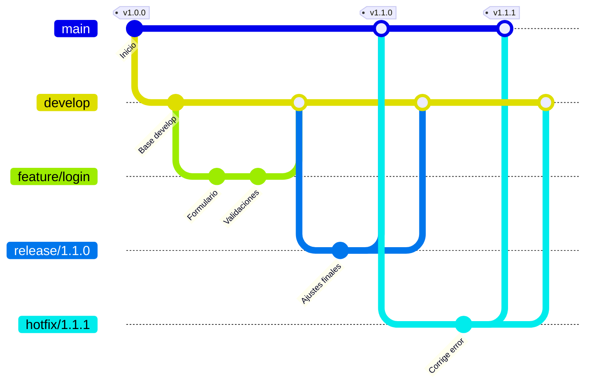
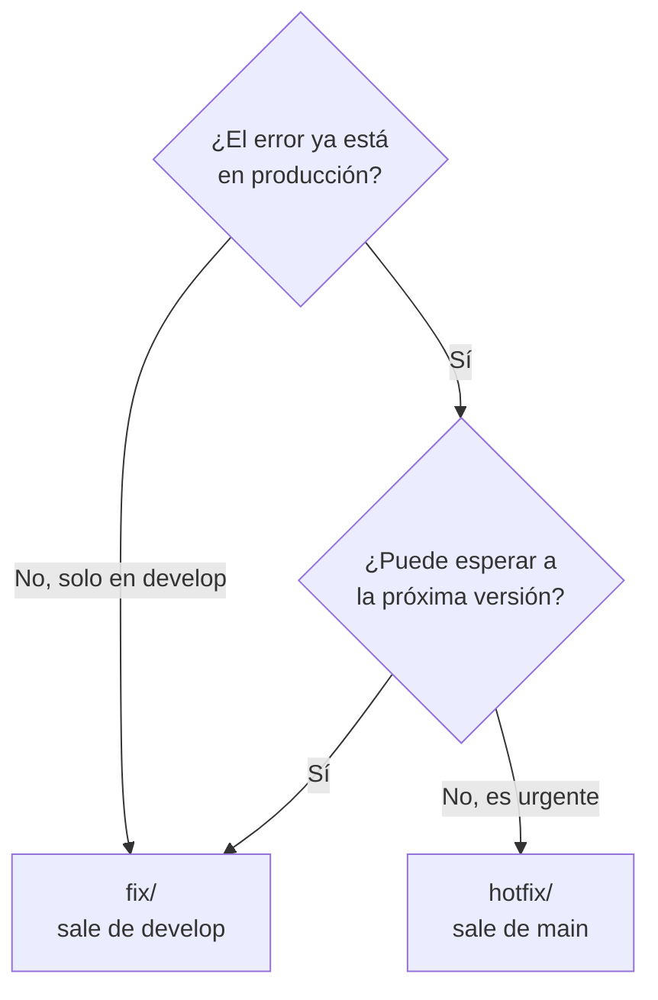

# 10. Estrategia de ramas: Git Flow y tipos de rama

[← Seguridad y colaboradores](09-seguridad-y-colaboradores.md) · [Índice de comandos →](indice-de-comandos.md)

Una **estrategia de ramas** es el acuerdo del equipo sobre *qué ramas existen*, *cómo se llaman* y *por dónde viaja un cambio* hasta llegar a producción. Sin ese acuerdo, cada persona trabaja a su manera y el repositorio se vuelve difícil de entender.

Este capítulo adopta **Git Flow** como estándar y lo combina con una **convención de tipos de rama** para identificar de un vistazo qué contiene cada una.

## Contenido

1. [Dos ideas distintas: flujo y tipo](#101-dos-ideas-distintas-flujo-y-tipo)
2. [Git Flow: las ramas y su recorrido](#102-git-flow-las-ramas-y-su-recorrido)
3. [Catálogo de tipos de rama](#103-catálogo-de-tipos-de-rama)
4. [Cómo nombrar las ramas](#104-cómo-nombrar-las-ramas)
5. [Paso a paso: feature, release y hotfix](#105-paso-a-paso)
6. [Mensajes de commit con Conventional Commits](#106-mensajes-de-commit-con-conventional-commits)
7. [Versiones con Semantic Versioning](#107-versiones-con-semantic-versioning)
8. [Configurar GitHub para Git Flow](#108-configurar-github-para-git-flow)
9. [Otras estrategias y cuándo elegirlas](#109-otras-estrategias-y-cuándo-elegirlas)
10. [Errores frecuentes](#1010-errores-frecuentes)
11. [Resumen para el equipo](#1011-resumen-para-el-equipo)

---

## 10.1 Dos ideas distintas: flujo y tipo

Es común confundirlas, pero responden a preguntas diferentes:

| | **Flujo de ramas** | **Tipo de rama** |
|---|---|---|
| Pregunta | ¿De dónde sale mi rama y a dónde se une? | ¿Qué clase de cambio contiene? |
| Ejemplos | Git Flow, GitHub Flow, trunk-based | `feature`, `fix`, `chore`, `refactor`, `docs`… |
| Origen | Git Flow fue propuesto por Vincent Driessen en 2010 | Los tipos vienen de la convención **Conventional Commits** |

**Git Flow define pocos tipos:** `feature`, `release` y `hotfix`, además de las ramas permanentes `main` y `develop`. Los tipos `chore`, `refactor`, `docs`, `test`, etc. **no son parte de Git Flow**, pero encajan perfectamente en él: se comportan como una `feature` (salen de `develop` y vuelven a `develop`) y solo cambia el prefijo para describir mejor el trabajo.

---

## 10.2 Git Flow: las ramas y su recorrido

### Ramas permanentes (nunca se borran)

| Rama | Contiene | Regla |
|---|---|---|
| **`main`** | Exactamente lo que está en **producción** | Solo recibe merges desde `release/*` y `hotfix/*`. Cada merge lleva un tag de versión. |
| **`develop`** | El trabajo terminado que irá en la **próxima versión** | Recibe merges de las ramas de trabajo. Es la base para crear ramas nuevas. |

### Ramas temporales (se borran tras el merge)

| Rama | Sale de | Se une a | Para qué |
|---|---|---|---|
| **`feature/*`** y demás tipos de trabajo | `develop` | `develop` | Desarrollo del día a día |
| **`release/*`** | `develop` | `main` **y** `develop` | Preparar y estabilizar una versión |
| **`hotfix/*`** | `main` | `main` **y** `develop` | Corregir un error urgente en producción |

### El recorrido completo



Leído en palabras:

1. Las funcionalidades se desarrollan en `feature/*` y se unen a `develop`.
2. Cuando `develop` tiene suficiente para una entrega, se crea `release/1.1.0` para las pruebas finales. Ahí ya **no entran funcionalidades nuevas**, solo correcciones.
3. La release se une a `main` (y se marca `v1.1.0`) **y también a `develop`**, para no perder las correcciones hechas durante las pruebas.
4. Si aparece un error grave en producción, se crea `hotfix/1.1.1` **desde `main`**, se corrige, se une a `main` (`v1.1.1`) **y a `develop`**.

> **Regla de oro de Git Flow:** todo lo que entra a `main` también debe entrar a `develop`. Si no, la siguiente versión "revive" el error corregido.

---

## 10.3 Catálogo de tipos de rama

Todas las ramas de trabajo salen de `develop` y vuelven a `develop`, excepto `release/` y `hotfix/`.

| Tipo | Úsalo cuando… | Ejemplo de nombre | Sale de → se une a |
|---|---|---|---|
| **`feature/`** | Agregas una funcionalidad nueva para el usuario | `feature/123-exportar-excel` | `develop` → `develop` |
| **`fix/`** | Corriges un error detectado **antes** de llegar a producción | `fix/145-calculo-iva` | `develop` → `develop` |
| **`hotfix/`** | Corriges un error **urgente en producción** | `hotfix/1.4.1-caida-pagos` | `main` → `main` + `develop` |
| **`release/`** | Preparas una nueva versión para producción | `release/1.5.0` | `develop` → `main` + `develop` |
| **`refactor/`** | Reorganizas código **sin cambiar** lo que hace | `refactor/separar-capa-datos` | `develop` → `develop` |
| **`perf/`** | Mejoras el rendimiento | `perf/indices-reporte-ventas` | `develop` → `develop` |
| **`docs/`** | Cambias solo documentación | `docs/manual-instalacion` | `develop` → `develop` |
| **`test/`** | Agregas o corriges pruebas automatizadas | `test/pruebas-modulo-facturas` | `develop` → `develop` |
| **`chore/`** | Mantenimiento que no afecta al usuario: dependencias, configuración, limpieza | `chore/actualizar-dependencias` | `develop` → `develop` |
| **`ci/`** | Cambias pipelines o GitHub Actions | `ci/pruebas-en-pull-request` | `develop` → `develop` |
| **`build/`** | Cambias el sistema de compilación o empaquetado | `build/migrar-a-dotnet-8` | `develop` → `develop` |
| **`style/`** | Solo formato: espacios, comas, sangría, sin cambiar lógica | `style/aplicar-formateador` | `develop` → `develop` |

> Algunos equipos usan `bugfix/` en lugar de `fix/`. Elijan **uno** y úsenlo siempre.

### ¿`fix/` o `hotfix/`?



### ¿`feature/`, `refactor/` o `chore/`?

- ¿El usuario **notará** algo nuevo? → `feature/`
- ¿El código queda **distinto pero hace lo mismo**? → `refactor/`
- ¿Es **mantenimiento** (dependencias, configuración, archivos de proyecto)? → `chore/`

---

## 10.4 Cómo nombrar las ramas

### Formato

```text
<tipo>/<id-del-ticket>-<descripcion-corta>
```

El id del ticket es opcional, pero muy recomendado si usan issues de GitHub, Jira, GLPI u otro sistema.

### Reglas

| ✅ Hacer | ❌ Evitar |
|---|---|
| Minúsculas: `feature/login-sso` | `Feature/Login-SSO` |
| Guiones para separar palabras | Espacios o guiones bajos: `feature/login sso`, `feature/login_sso` |
| Sin acentos ni ñ: `feature/configuracion-anio` | `feature/configuración-año` |
| Descripción corta, 2 a 5 palabras | `feature/agrega-el-nuevo-modulo-de-reportes-mensuales-para-gerencia` |
| Describe el **qué**: `fix/123-total-factura` | Nombres sin contexto: `fix/arreglo`, `feature/juan`, `prueba2` |
| Releases y hotfixes con versión: `release/2.3.0` | `release/nueva`, `hotfix/urgente` |

---

## 10.5 Paso a paso

### Preparar el repositorio (una sola vez)

```powershell
git switch main
git pull
git switch -c develop
git push -u origin develop
```

Después, configura `develop` como rama por defecto en GitHub (ver [10.8](#108-configurar-github-para-git-flow)).

### A. Trabajar en una feature (o fix, chore, refactor, docs…)

```powershell
# 1. Parte siempre de develop actualizado
git switch develop
git pull

# 2. Crea la rama
git switch -c feature/123-exportar-excel

# 3. Trabaja con commits pequeños
git add .
git commit -m "feat(reportes): agrega botón de exportación a Excel"

# 4. Sube la rama
git push -u origin feature/123-exportar-excel
```

5. En GitHub, abre un **pull request** con base **`develop`**.
6. Tras la aprobación: **Merge** y **Delete branch**.
7. Limpia tu copia local:

```powershell
git switch develop
git pull
git branch -d feature/123-exportar-excel
```

### B. Publicar una versión (release)

```powershell
# 1. Crea la release desde develop
git switch develop
git pull
git switch -c release/1.5.0
git push -u origin release/1.5.0
```

2. Prueba la versión. Solo se permiten **correcciones** en esta rama: commits `fix:` y ajustes de versión o documentación.
3. Abre un PR **`release/1.5.0` → `main`**, apruébalo y haz merge.
4. Crea el tag sobre `main`:

```powershell
git switch main
git pull
git tag -a v1.5.0 -m "Versión 1.5.0"
git push origin v1.5.0
```

5. Devuelve los cambios a `develop`: abre un PR **`release/1.5.0` → `develop`** y haz merge, o desde la terminal:

```powershell
git switch develop
git pull
git merge --no-ff release/1.5.0
git push
```

6. Borra la rama `release/1.5.0`.
7. Opcional: en GitHub, *Releases → Draft a new release* sobre el tag `v1.5.0`, con las notas de la versión.

### C. Corregir un error urgente en producción (hotfix)

```powershell
# 1. Sale de main, NO de develop
git switch main
git pull
git switch -c hotfix/1.5.1-caida-pagos

# 2. Corrige y sube
git add .
git commit -m "fix(pagos): evita caída cuando el banco no responde"
git push -u origin hotfix/1.5.1-caida-pagos
```

3. PR **`hotfix/1.5.1-caida-pagos` → `main`** → merge → tag `v1.5.1` (igual que en la release).
4. PR **`hotfix/1.5.1-caida-pagos` → `develop`** → merge. **No te saltes este paso.**
5. Borra la rama.

> **¿Por qué `--no-ff`?** Fuerza un commit de merge aunque Git pudiera "avanzar" la rama sin él. Así el historial muestra claramente cuándo se integró cada rama. Los PR de GitHub con *Create a merge commit* hacen lo mismo.

### ¿Qué opción de merge usar en GitHub?

| PR hacia… | Opción recomendada | Por qué |
|---|---|---|
| `develop` desde `feature/*`, `fix/*`, etc. | **Squash and merge** | Cada funcionalidad queda como un solo commit limpio en `develop` |
| `main` desde `release/*` o `hotfix/*` | **Create a merge commit** | Conserva la relación entre ramas; evita conflictos al devolver los cambios a `develop` |
| `develop` desde `release/*` o `hotfix/*` | **Create a merge commit** | Igual que la anterior |

---

## 10.6 Mensajes de commit con Conventional Commits

Los mismos tipos de rama se usan como prefijo del **mensaje de commit**. Así, el historial se puede leer y filtrar por tipo de cambio.

### Formato

```text
<tipo>(<alcance opcional>): <descripción en imperativo>
```

### Ejemplos

```text
feat(reportes): agrega exportación a Excel
fix(facturas): corrige redondeo del IVA
docs: actualiza guía de instalación
refactor(api): separa validaciones en un servicio
chore: actualiza dependencias de seguridad
test(login): agrega pruebas de contraseña vencida
ci: ejecuta pruebas en cada pull request
```

### Relación entre rama y commit

| Rama | Prefijo de commit |
|---|---|
| `feature/…` | `feat:` |
| `fix/…` y `hotfix/…` | `fix:` |
| `refactor/…` | `refactor:` |
| `perf/…` | `perf:` |
| `docs/…` | `docs:` |
| `test/…` | `test:` |
| `chore/…` | `chore:` |
| `ci/…` | `ci:` |
| `build/…` | `build:` |
| `style/…` | `style:` |

Un cambio que **rompe compatibilidad** se marca con `!`, por ejemplo `feat(api)!: elimina el endpoint /v1/clientes`.

> Una rama `feature/` puede contener commits de otros tipos (`test:`, `docs:`). El tipo de la rama describe el objetivo **principal**.

---

## 10.7 Versiones con Semantic Versioning

Las ramas `release/` y `hotfix/` y los tags usan el formato **`MAYOR.MENOR.PARCHE`** (por ejemplo, `2.4.1`):

| Sube… | Cuándo | Ejemplo |
|---|---|---|
| **MAYOR** | Cambios que **rompen** compatibilidad (`!` en el commit) | `2.4.1` → `3.0.0` |
| **MENOR** | Funcionalidades nuevas compatibles (`feat:`) | `2.4.1` → `2.5.0` |
| **PARCHE** | Solo correcciones (`fix:`), típicamente un hotfix | `2.4.1` → `2.4.2` |

Por eso:
- una **release** normalmente sube MENOR o MAYOR (`release/2.5.0`);
- un **hotfix** sube PARCHE (`hotfix/2.4.2-…`).

---

## 10.8 Configurar GitHub para Git Flow

### 1. `develop` como rama por defecto

*Settings → General → Default branch* → ícono de cambio → **`develop`**.

Así los PRs se crean contra `develop` automáticamente y quien clone el repo empieza en `develop`.

### 2. Proteger `main` y `develop`

*Settings → Rules → Rulesets → New branch ruleset*. Crea **dos** rulesets:

| Regla | `main` | `develop` |
|---|:-:|:-:|
| Restrict deletions | ✅ | ✅ |
| Block force pushes | ✅ | ✅ |
| Require a pull request before merging | ✅ (2 aprobaciones) | ✅ (1 aprobación) |
| Require review from Code Owners ([cap. 9](09-seguridad-y-colaboradores.md#97-responsables-de-código-codeowners)) | ✅ | Opcional |
| Require status checks to pass | ✅ si hay pruebas | ✅ si hay pruebas |

> Recuerda: en repositorios **privados**, los rulesets requieren GitHub Team o superior.

### 3. Borrar ramas automáticamente

*Settings → General → Pull Requests* → activa **Automatically delete head branches**. Las ramas de trabajo se borran solas al hacer merge.

> ⚠️ Esto también borra la rama `release/*` o `hotfix/*` en cuanto se une a `main`, antes de que la devuelvas a `develop`. En ese caso, devuélvela desde `main` (`git merge --no-ff main` estando en `develop`) o restaura la rama con el botón **Restore branch** del PR.

### 4. Validar el nombre de las ramas automáticamente

Este workflow de GitHub Actions rechaza los PRs cuya rama no cumpla la convención. Guárdalo como `.github/workflows/validar-nombre-rama.yml`:

```yaml
name: Validar nombre de rama
on:
  pull_request:
    types: [opened, reopened, synchronize]
jobs:
  validar:
    runs-on: ubuntu-latest
    steps:
      - name: Revisar el nombre de la rama
        env:
          RAMA: ${{ github.head_ref }}
        run: |
          patron='^(feature|fix|hotfix|release|refactor|perf|docs|test|chore|ci|build|style)/[a-z0-9._-]+$'
          if [[ ! "$RAMA" =~ $patron ]]; then
            echo "::error::La rama '$RAMA' no sigue la convención <tipo>/<descripcion>. Consulta docs/10-estrategia-de-ramas.md"
            exit 1
          fi
          echo "Nombre de rama válido: $RAMA"
```

Para que sea obligatorio, agrega este check en **Require status checks to pass** del ruleset.

### 5. Plantilla de pull request

Amplía la plantilla del [capítulo 7](07-buenas-practicas.md#plantilla-de-pull-request) con el tipo de cambio:

```markdown
## Tipo de cambio
- [ ] feature  - [ ] fix  - [ ] hotfix  - [ ] refactor
- [ ] docs     - [ ] test - [ ] chore   - [ ] otro: ___
```

---

## 10.9 Otras estrategias y cuándo elegirlas

| | **Git Flow** | **GitHub Flow** | **Trunk-based** |
|---|---|---|---|
| Ramas permanentes | `main` + `develop` | Solo `main` | Solo `main` |
| Ramas de trabajo | `feature`, `release`, `hotfix`… | Ramas cortas desde `main` | Muy cortas (horas) o directo a `main` |
| Ritmo de entregas | Versiones planificadas | Continuo, varias veces por semana | Continuo, varias veces al día |
| Complejidad | Media | Baja | Baja en ramas, alta en automatización |
| Requiere pruebas automáticas | Recomendable | Muy recomendable | **Indispensable** |
| Ideal para | Sistemas con fechas de entrega, ambientes de QA, aprobaciones formales | Aplicaciones web y equipos pequeños | Equipos con mucha madurez en CI/CD |

**Elige Git Flow si:**
- entregan versiones con fecha (por ejemplo, una por sprint o por mes);
- existe un ambiente de pruebas o QA antes de producción;
- necesitan aprobaciones formales o control de cambios;
- deben poder corregir producción sin publicar lo que está a medio desarrollar.

**Elige GitHub Flow si:** publican en cuanto algo está listo y el equipo es pequeño. Está explicado en el [capítulo 4](04-ramas-y-flujo.md#el-flujo-diario-recomendado-github-flow).

> **Los tipos de rama de la sección [10.3](#103-catálogo-de-tipos-de-rama) sirven para cualquiera de las tres estrategias.** En GitHub Flow, simplemente salen de `main` y vuelven a `main`.

---

## 10.10 Errores frecuentes

| Error | Consecuencia | Prevención |
|---|---|---|
| Crear una feature desde `main` | Se pierde lo que ya está en `develop`; aparecen conflictos | Siempre `git switch develop` y `git pull` antes de crear la rama |
| Crear un hotfix desde `develop` | Se publica a producción trabajo sin terminar | Los hotfix **siempre** salen de `main` |
| No devolver una release o hotfix a `develop` | El error corregido "revive" en la siguiente versión | Doble PR: hacia `main` **y** hacia `develop` |
| Features que viven semanas | Conflictos enormes al unir | Dividir el trabajo en partes de 1 a 3 días |
| Agregar funcionalidades a una `release/` | La versión nunca se estabiliza | En `release/` solo entran correcciones |
| Subir directo a `main` o `develop` | Cambios sin revisión en producción | Rulesets ([10.8](#108-configurar-github-para-git-flow)) |
| Nombres como `prueba`, `cambios-juan` | Nadie sabe qué contiene la rama | Convención de nombres y validación automática |

---

## 10.11 Resumen para el equipo

```text
RAMAS PERMANENTES
  main      → producción. Solo desde release/ o hotfix/. Siempre con tag.
  develop   → próxima versión. Base de todo el trabajo.

RAMAS DE TRABAJO (salen de develop → vuelven a develop)
  feature/  fix/  refactor/  perf/  docs/  test/  chore/  ci/  build/  style/

RAMAS DE ENTREGA
  release/X.Y.Z   develop → main + develop   (solo correcciones)
  hotfix/X.Y.Z-…  main    → main + develop   (urgencias en producción)

NOMBRE     <tipo>/<ticket>-<descripcion-corta>    minúsculas, guiones, sin acentos
COMMIT     <tipo>(<alcance>): <descripción>       feat: fix: docs: chore: …
VERSIÓN    MAYOR.MENOR.PARCHE                     tag vX.Y.Z en main
SIEMPRE    pull request + revisión; nunca push directo a main ni a develop
```

---

[← Seguridad y colaboradores](09-seguridad-y-colaboradores.md) · [Índice de comandos →](indice-de-comandos.md)
