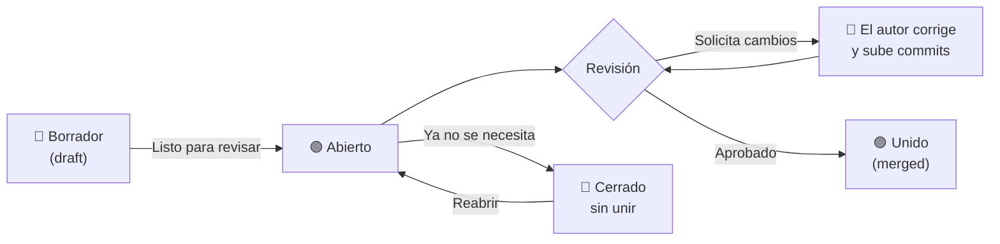

# 11. Administrar pull requests

[← Estrategia de ramas](10-estrategia-de-ramas.md) · [Índice de comandos →](indice-de-comandos.md)

En el [capítulo 5](05-trabajo-en-equipo.md#pull-requests-pr) aprendiste qué es un pull request (PR) y cómo abrirlo, revisarlo y unirlo. Este capítulo cubre el **día a día**: organizar los PRs, responder a revisiones, mantenerlos actualizados, encontrarlos rápido y administrarlos desde la terminal.

Cada acción se explica de dos formas:
- 🌐 **En la web de GitHub**, la forma más visual.
- 💻 **Con GitHub CLI (`gh`)**, la forma más rápida. Ver la instalación en el [capítulo 2.4](02-instalacion.md#opción-b--github-cli-gh).

## Contenido

1. [El ciclo de vida de un PR](#111-el-ciclo-de-vida-de-un-pr)
2. [Crear un PR completo](#112-crear-un-pr-completo)
3. [Borradores (draft)](#113-borradores-draft)
4. [Organizar: revisores, responsables, etiquetas e issues](#114-organizar-revisores-responsables-etiquetas-e-issues)
5. [Revisar un PR a fondo](#115-revisar-un-pr-a-fondo)
6. [Responder a una revisión](#116-responder-a-una-revisión)
7. [Mantener el PR actualizado y resolver conflictos](#117-mantener-el-pr-actualizado-y-resolver-conflictos)
8. [Unir un PR](#118-unir-un-pr)
9. [Cerrar sin unir y reabrir](#119-cerrar-sin-unir-y-reabrir)
10. [Buscar y filtrar PRs](#1110-buscar-y-filtrar-prs)
11. [Configurar los PRs del repositorio](#1111-configurar-los-prs-del-repositorio)
12. [Ejemplo real: el PR #1 de este manual](#1112-ejemplo-real-el-pr-1-de-este-manual)
13. [Resumen de comandos `gh pr`](#1113-resumen-de-comandos-gh-pr)

---

## 11.1 El ciclo de vida de un PR



| Estado | Ícono en GitHub | Significa |
|---|---|---|
| **Draft** | Gris | Trabajo en progreso; aún no pide revisión |
| **Open** | Verde | Esperando revisión o correcciones |
| **Merged** | Morado | Sus cambios ya están en la rama destino |
| **Closed** | Rojo | Se cerró **sin** unir los cambios |

---

## 11.2 Crear un PR completo

Un buen PR no es solo código: tiene **título claro, descripción, revisores y destino correcto**.

### 🌐 En la web

1. Sube tu rama (`git push -u origin <rama>`).
2. Aparece el aviso **Compare & pull request** → clic. También puedes ir a la pestaña **Pull requests → New pull request**.
3. Verifica la dirección: **base** (destino) ← **compare** (tu rama). En Git Flow, la base suele ser `develop` ([capítulo 10](10-estrategia-de-ramas.md#102-git-flow-las-ramas-y-su-recorrido)).
4. Escribe título y descripción. Si existe una plantilla ([capítulo 7](07-buenas-practicas.md#plantilla-de-pull-request)), aparecerá automáticamente.
5. En la barra derecha completa **Reviewers**, **Assignees** y **Labels** (ver [11.4](#114-organizar-revisores-responsables-etiquetas-e-issues)).
6. **Create pull request**, o usa la flecha junto al botón y elige **Create draft pull request**.

### 💻 Con `gh`

```powershell
gh pr create --base develop --title "feat: exporta reportes a Excel" --body "Closes #12" --reviewer usuario-revisor --assignee "@me" --label mejora
```

| Opción | Para qué |
|---|---|
| `--base develop` | Rama destino |
| `--title` / `--body` | Título y descripción |
| `--body-file archivo.md` | Toma la descripción de un archivo (útil para descripciones largas) |
| `--fill` | Usa los mensajes de commit como título y descripción |
| `--reviewer usuario` | Pide revisión (también `org/equipo`) |
| `--assignee "@me"` | Te asigna como responsable |
| `--label nombre` | Agrega una etiqueta (debe existir en el repo) |
| `--draft` | Lo crea como borrador |
| `--web` | Abre el formulario en el navegador para terminarlo ahí |

---

## 11.3 Borradores (draft)

Un **borrador** es un PR que dice *"todavía no está listo, pero quiero que vean el avance"*. Sirve para:
- recibir comentarios tempranos sin pedir aprobación formal;
- que las pruebas automáticas corran desde el principio;
- que el equipo sepa en qué estás trabajando.

Mientras es borrador, **no se puede unir** y GitHub **no notifica** a los responsables de [CODEOWNERS](09-seguridad-y-colaboradores.md#97-responsables-de-código-codeowners).

| Acción | 🌐 Web | 💻 `gh` |
|---|---|---|
| Crear como borrador | Flecha junto a *Create pull request* → **Create draft pull request** | `gh pr create --draft` |
| Marcar como listo | Botón **Ready for review** al final del PR | `gh pr ready <número>` |
| Volver a borrador | Barra derecha, sección *Reviewers* → **Convert to draft** | `gh pr ready <número> --undo` |

> En repositorios **privados**, los borradores requieren un plan de pago (Pro, Team o Enterprise). En repositorios públicos son gratis.

---

## 11.4 Organizar: revisores, responsables, etiquetas e issues

### La barra derecha del PR

| Campo | Para qué sirve | Ejemplo |
|---|---|---|
| **Reviewers** | Quién debe **revisar** y aprobar | El líder técnico |
| **Assignees** | Quién es **responsable** de llevar el PR hasta el final (normalmente el autor) | Tú |
| **Labels** | **Clasificar** el PR | `documentación`, `urgente`, `bug` |
| **Projects** | Mostrarlo en un tablero Kanban | "Sprint 14" |
| **Milestone** | Agruparlo en una versión o fecha | "Versión 1.2.0" |
| **Development** | Vincularlo a uno o varios **issues** | Issue #12 |

> **Reviewer ≠ Assignee.** El *reviewer* revisa; el *assignee* es quien debe moverlo. Si nadie es responsable, el PR se queda olvidado.

### Etiquetas recomendadas

Crea las etiquetas en *Issues → Labels → New label*. Un conjunto inicial alineado con los tipos de rama del [capítulo 10](10-estrategia-de-ramas.md#103-catálogo-de-tipos-de-rama):

| Etiqueta | Uso |
|---|---|
| `feature` | Funcionalidad nueva |
| `fix` | Corrección de error |
| `hotfix` | Urgente en producción |
| `docs` | Documentación |
| `chore` | Mantenimiento |
| `necesita-cambios` | El revisor pidió correcciones |
| `bloqueado` | Depende de otra cosa para avanzar |

### Vincular un PR con un issue

Escribe en la **descripción** del PR una palabra clave seguida del número del issue:

```text
Closes #12
Fixes #15
Resolves #20
```

Cuando el PR se une, **GitHub cierra esos issues automáticamente**.

> ⚠️ **Importante en Git Flow:** el cierre automático **solo ocurre cuando el PR se une a la rama por defecto** del repositorio. Si tu rama por defecto es `main` y el PR va hacia `develop`, el issue **no** se cerrará hasta que esos cambios lleguen a `main` en una release. Si configuras `develop` como rama por defecto ([10.8](10-estrategia-de-ramas.md#108-configurar-github-para-git-flow)), se cerrará al unir a `develop`.

### 💻 Con `gh`

```powershell
gh pr edit 12 --add-reviewer usuario-revisor --add-assignee "@me" --add-label docs
```
```powershell
gh pr edit 12 --remove-label bloqueado
```

---

## 11.5 Revisar un PR a fondo

### 🌐 En la web, pestaña **Files changed**

1. **Revisa archivo por archivo.** Marca la casilla **Viewed** en cada uno para llevar la cuenta de lo que ya revisaste.
2. **Comenta una línea:** pasa el ratón sobre la línea → clic en el **+** azul → escribe → **Start a review**. Así juntas todos tus comentarios en una sola revisión, en lugar de enviar una notificación por cada uno.
3. **Sugiere un cambio concreto:** en el comentario, haz clic en el ícono de **sugerencia** (±) o escribe:

   ````markdown
   ```suggestion
   Texto corregido de la línea
   ```
   ````

   El autor podrá aceptarla con un clic (**Commit suggestion**).
4. **Termina la revisión:** botón **Review changes** (arriba a la derecha) → escribe un resumen → elige:

| Opción | Cuándo |
|---|---|
| **Comment** | Solo observaciones; no bloquea ni aprueba |
| **Approve** | Todo está bien; puede unirse |
| **Request changes** | Hay que corregir antes de unir |

> No puedes aprobar ni pedir cambios en **tus propios** PRs. Solo puedes comentar.

### 💻 Con `gh`

```powershell
gh pr view 12                 # resumen del PR
gh pr diff 12                 # ver los cambios
gh pr checkout 12             # descargar la rama del PR para probarla en tu equipo
gh pr review 12 --approve -b "Revisado, todo correcto"
gh pr review 12 --request-changes -b "Falta validar el campo correo"
gh pr review 12 --comment -b "Sugiero renombrar la variable"
```

> **Consejo:** `gh pr checkout` es muy útil para **probar** el cambio antes de aprobarlo. Al terminar, vuelve a tu rama con `git switch develop`.

---

## 11.6 Responder a una revisión

Cuando un revisor pide cambios, **no abras un PR nuevo**. Corrige en **la misma rama**: el PR se actualiza solo.

```powershell
git switch feature/123-exportar-excel
# ...haces las correcciones...
git add .
git commit -m "fix: valida el campo correo según la revisión"
git push
```

Después, en el PR:

1. **Responde** cada comentario (por ejemplo, *"Corregido en el último commit"*).
2. Haz clic en **Resolve conversation** en los comentarios ya atendidos.
3. **Vuelve a pedir la revisión:** en *Reviewers*, clic en el ícono 🔄 junto al nombre del revisor.

💻 Para comentar desde la terminal:

```powershell
gh pr comment 12 --body "Listo, ya apliqué los cambios solicitados"
```

---

## 11.7 Mantener el PR actualizado y resolver conflictos

Mientras tu PR espera revisión, otros PRs pueden unirse a la rama destino. Tu rama queda **desactualizada** y, si tocaron los mismos archivos, con **conflictos**.

### Si solo está desactualizado

🌐 Si aparece el botón **Update branch** al final del PR, haz clic: GitHub une la rama destino en la tuya.

💻 O desde tu equipo:

```powershell
git switch feature/123-exportar-excel
git pull                     # trae lo último de tu rama
git merge origin/develop     # une lo nuevo de develop
git push
```

(Antes ejecuta `git fetch` para que `origin/develop` esté al día.)

### Si tiene conflictos

GitHub muestra el aviso **This branch has conflicts that must be resolved**.

- 🌐 **Conflictos simples:** botón **Resolve conflicts** → GitHub abre un editor con las marcas `<<<<<<<`, `=======` y `>>>>>>>` → deja el texto correcto, borra las marcas → **Mark as resolved** → **Commit merge**.
- 💻 **Conflictos complejos:** resuélvelos en tu equipo con el mismo `git merge origin/develop` de arriba. Git te indicará los archivos en conflicto ([capítulo 4](04-ramas-y-flujo.md#conflictos-de-merge)). Corrígelos, luego `git add`, `git commit` y `git push`.

---

## 11.8 Unir un PR

Antes de unir, verifica al final del PR:

- ✅ Las aprobaciones requeridas.
- ✅ Las verificaciones automáticas (checks) en verde, si existen.
- ✅ Sin conflictos.

Qué opción de merge usar en cada caso se explica en el [capítulo 10](10-estrategia-de-ramas.md#qué-opción-de-merge-usar-en-github). En resumen: **Squash** hacia `develop` y **Merge commit** hacia `main`.

### 💻 Con `gh`

```powershell
gh pr merge 12 --squash --delete-branch    # feature → develop
gh pr merge 13 --merge                     # release → main
```

### Unión automática (auto-merge)

Si el PR está aprobado pero las pruebas aún corren, puedes programarlo para que **se una solo** cuando todo pase:

- 🌐 Botón **Enable auto-merge**.
- 💻 `gh pr merge 12 --squash --auto`

> Requiere activar *Allow auto-merge* en la configuración ([11.11](#1111-configurar-los-prs-del-repositorio)) y tener reglas de protección en la rama destino.

---

## 11.9 Cerrar sin unir y reabrir

Cierra un PR cuando el cambio ya no se necesita, se reemplazó por otro o se descartó la idea. **Siempre deja un comentario** explicando el motivo.

| Acción | 🌐 Web | 💻 `gh` |
|---|---|---|
| Cerrar | Botón **Close pull request** | `gh pr close 12 --comment "Reemplazado por #15"` |
| Cerrar y borrar la rama | Cerrar → **Delete branch** | `gh pr close 12 --delete-branch` |
| Reabrir | Botón **Reopen pull request** | `gh pr reopen 12` |
| Recuperar una rama borrada | Botón **Restore branch** en el PR | — |

> Un PR cerrado **no se borra**: queda en el historial con sus comentarios, como registro de la decisión.

---

## 11.10 Buscar y filtrar PRs

### 🌐 En la web

En la pestaña **Pull requests** de cada repo, escribe filtros en la barra de búsqueda:

| Filtro | Muestra |
|---|---|
| `is:pr is:open` | Todos los abiertos (filtro por defecto) |
| `is:pr is:open review-requested:@me` | **Los que esperan tu revisión** |
| `is:pr author:@me` | Los que abriste tú |
| `is:pr assignee:@me` | Los que tienes asignados |
| `is:pr is:draft` | Borradores |
| `is:pr base:develop` | Los que van hacia `develop` |
| `is:pr label:urgente` | Con cierta etiqueta |
| `is:pr is:merged` | Los ya unidos |
| `is:pr review:changes_requested` | Los que tienen cambios pendientes |

Los filtros se combinan: `is:pr is:open base:develop label:fix`.

> **Panel personal:** <https://github.com/pulls> muestra tus PRs de **todos** los repositorios: creados, asignados, menciones y revisiones pendientes.

### 💻 Con `gh`

```powershell
gh pr status                              # tu resumen: tus PRs y los que esperan tu revisión
gh pr list                                # abiertos del repo actual
gh pr list --state merged --limit 10      # los últimos 10 unidos
gh pr list --base develop --label fix     # filtrar por destino y etiqueta
gh pr list --search "review-requested:@me"
gh pr checks 12                           # estado de las verificaciones automáticas
```

---

## 11.11 Configurar los PRs del repositorio

*Settings → General →* sección **Pull Requests**:

| Opción | Recomendación | Por qué |
|---|---|---|
| **Allow merge commits** | ✅ | Necesaria para release y hotfix hacia `main` |
| **Allow squash merging** | ✅ | Para features hacia `develop` |
| **Allow rebase merging** | ❌ (opcional) | Menos opciones = menos confusión para quien empieza |
| **Always suggest updating pull request branches** | ✅ | Muestra el botón *Update branch* |
| **Allow auto-merge** | ✅ | Permite la unión automática |
| **Automatically delete head branches** | ✅ con cuidado | Limpia ramas al unir. Lee la advertencia sobre release y hotfix en [10.8](10-estrategia-de-ramas.md#108-configurar-github-para-git-flow) |

Complementos ya explicados:

- **Revisiones obligatorias** y **ramas protegidas:** [capítulo 5](05-trabajo-en-equipo.md#proteger-la-rama-main) y [10.8](10-estrategia-de-ramas.md#108-configurar-github-para-git-flow).
- **Revisores automáticos:** [CODEOWNERS, 9.7](09-seguridad-y-colaboradores.md#97-responsables-de-código-codeowners).
- **Plantilla de descripción:** [capítulo 7](07-buenas-practicas.md#plantilla-de-pull-request).

---

## 11.12 Ejemplo real: el PR #1 de este manual

La versión 1.1.0 de este manual se publicó con el PR [#1](https://github.com/Pegre369/curso-git/pull/1). Así fue su recorrido:

| Paso | Qué se hizo | Comando |
|---|---|---|
| 1 | Se crearon las ramas `feature/capitulo-2`, `feature/capitulo-3`, `docs/codeowners-explicado` y `docs/licencia`, y se unieron a `develop` | `git switch -c …` y `git merge --no-ff …` |
| 2 | Desde `develop` se creó la rama de entrega | `git switch -c release/1.1.0 develop` |
| 3 | Se subió la rama | `git push -u origin release/1.1.0` |
| 4 | Se abrió el PR hacia `main` con una descripción en archivo | `gh pr create --base main --head release/1.1.0 --title "…" --body-file notas.md` |
| 5 | Se revisó la pestaña *Files changed* y se unió con **Create a merge commit** | Web |
| 6 | Se marcó la versión | `git tag -a v1.1.0 -m "…"` y `git push origin v1.1.0` |
| 7 | Se limpiaron las ramas ya unidas | `git branch -d …` |

> **Lección aprendida:** el primer intento de crear el PR falló con *"Resource not accessible by personal access token"*. `gh` estaba autenticado con un token *fine-grained* sin permiso de escritura en pull requests. Se resolvió iniciando sesión por navegador: `gh auth login --web`. Más detalles en el [capítulo 8](08-solucion-de-problemas.md).

---

## 11.13 Resumen de comandos `gh pr`

| Comando | Qué hace |
|---|---|
| `gh pr create` | Crea un PR |
| `gh pr list` | Lista PRs del repositorio |
| `gh pr status` | Tus PRs y los que esperan tu revisión |
| `gh pr view <n>` | Muestra el detalle (`--web` lo abre en el navegador) |
| `gh pr diff <n>` | Muestra los cambios |
| `gh pr checkout <n>` | Descarga la rama del PR para probarla |
| `gh pr checks <n>` | Estado de las verificaciones automáticas |
| `gh pr review <n>` | Aprueba, pide cambios o comenta |
| `gh pr comment <n>` | Agrega un comentario |
| `gh pr edit <n>` | Cambia título, revisores, etiquetas, etc. |
| `gh pr ready <n>` | Pasa de borrador a listo (`--undo` para volver) |
| `gh pr merge <n>` | Une el PR (`--merge`, `--squash`, `--rebase`, `--auto`) |
| `gh pr close <n>` | Cierra sin unir |
| `gh pr reopen <n>` | Reabre un PR cerrado |

> En todos los comandos, `<n>` es el número del PR. Si estás parado en la rama del PR, puedes omitirlo.

---

[← Estrategia de ramas](10-estrategia-de-ramas.md) · [Índice de comandos →](indice-de-comandos.md)
